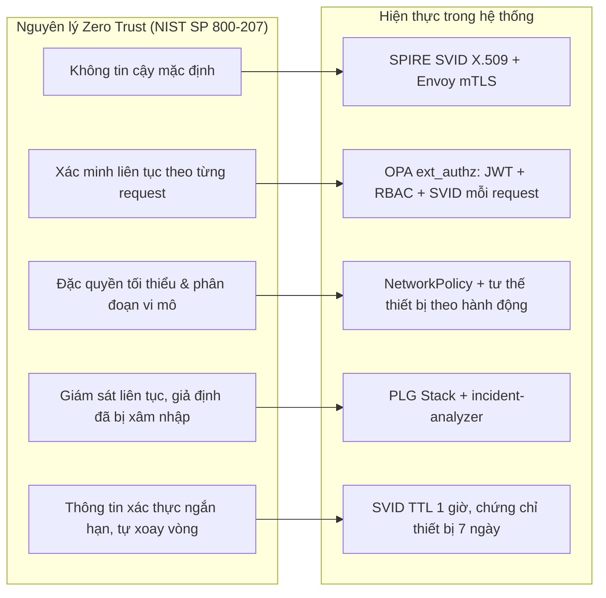
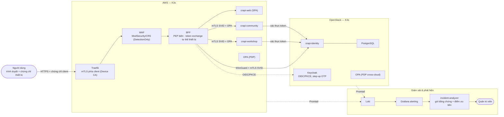

# Phát hiện và Phản ứng Sự cố An ninh dựa trên Kiến trúc Zero Trust cho Hệ thống Microservices Đa đám mây

**Zero-Trust-based Security Detection and Response for Multi-Cloud Microservices**

Khoá luận tốt nghiệp — Trường Đại học Công nghệ Thông tin, ĐHQG-HCM

---

## Tóm tắt

Kiến trúc microservices làm tăng mạnh bề mặt giao tiếp nội bộ (east–west) giữa các dịch vụ. Trong mô hình bảo mật dựa trên vành đai (perimeter-based), một dịch vụ đã nằm "bên trong" ranh giới mạng được mặc nhiên tin cậy, nên khi một dịch vụ bị chiếm quyền, kẻ tấn công có thể di chuyển ngang (lateral movement) mà không bị kiểm soát. Khoá luận hiện thực hoá các nguyên lý của **Kiến trúc Zero Trust theo NIST SP 800-207** trên một hệ microservices thật, triển khai **lai giữa hai đám mây (AWS và OpenStack)**, và xây dựng lớp **phát hiện – đóng gói bằng chứng** dựa trên log của chính các điểm thực thi chính sách.

Hệ thống sử dụng **SPIFFE/SPIRE** để cấp danh tính mật mã cho từng workload, **Istio/Envoy** làm điểm thực thi chính sách (PEP), **Open Policy Agent (OPA)** làm điểm quyết định chính sách (PDP) đánh giá từng request, **Keycloak** (OIDC/PKCE, step-up OTP) cho danh tính người dùng, chứng chỉ thiết bị (mTLS phía client) cho tư thế thiết bị, và **PLG Stack** (Promtail–Loki–Grafana) cùng dịch vụ `incident-analyzer` cho phát hiện và phân tích sự cố. Ứng dụng mục tiêu là **[OWASP crAPI](https://github.com/OWASP/crAPI)** — một ứng dụng microservices cố ý chứa lỗ hổng API.

Khoá luận gồm ba giai đoạn: **(A)** xây dựng và kiểm chứng hạ tầng Zero Trust; **(B)** thu thập bộ dữ liệu log có nhãn từ hệ thống đang vận hành dưới tải hợp lệ, nhiễu khó và chiến dịch tấn công; **(C)** xây dựng mô hình học máy/học sâu phát hiện hành vi bất thường trên bộ dữ liệu đó, bổ sung cho bộ luật phát hiện tĩnh.

---

## 1. Đặt vấn đề

### 1.1. Bài toán

Zero Trust là một tập nguyên lý rộng; phát biểu "áp dụng Zero Trust để tăng bảo mật" không đủ cụ thể để kiểm chứng. Khoá luận tập trung vào câu hỏi: **Zero Trust giải quyết loại lỗ hổng nào mà mô hình vành đai về mặt cấu trúc không giải quyết được, và chi phí vận hành thực tế của nó là bao nhiêu?**

Mô hình vành đai (kể cả VPC, security group, VPN) cấp niềm tin theo **vị trí mạng**. NIST SP 800-207 thay thế bằng **xác minh danh tính và đánh giá chính sách cho từng request, kể cả lưu lượng nội bộ**, thông qua một PDP tách biệt và các PEP đặt sát workload.

### 1.2. Mục tiêu

1. Hiện thực hoá một kiến trúc Zero Trust trên hệ microservices đa đám mây bằng các thành phần mã nguồn mở, có khả năng tái dựng hoàn toàn từ mã nguồn (Infrastructure as Code).
2. Kiểm chứng bằng thực nghiệm rằng các chính sách **thật sự được thực thi** trên cụm đang chạy, không chỉ tồn tại trong manifest.
3. Đo lường chi phí vận hành và chi phí runtime (độ trễ, tài nguyên) của lớp Zero Trust.
4. Xây dựng bộ dữ liệu log có nhãn thu từ hệ thống thật, làm nền cho mô hình phát hiện bất thường dựa trên học máy.

### 1.3. Phạm vi và giới hạn

- Khoá luận **không đề xuất một mô hình Zero Trust mới**; đây là một hiện thực hoá cụ thể của SP 800-207, áp dụng có chọn lọc vào các tenet đo lường được bằng thực nghiệm.
- Các lỗ hổng tầng ứng dụng của crAPI (BOLA, BFLA, JWT confusion, SSRF, mass assignment…) được **giữ nguyên có chủ đích**. Đóng góp nằm ở lớp Zero Trust và lớp phát hiện bao quanh ứng dụng: chặn di chuyển ngang, leo thang đặc quyền qua mạng, phát lại thông tin xác thực, buộc xác thực bước hai, và phát hiện, đóng gói bằng chứng khi lỗ hổng ứng dụng bị khai thác.
- Chính sách OPA, luật cảnh báo và luật WAF được viết riêng cho bề mặt tấn công của hệ thống này; chúng không phải sản phẩm có thể áp dụng nguyên trạng cho hệ thống khác.
- `incident-analyzer` **chỉ phân tích và thông báo**, không tự thực thi hành động khắc phục trên cụm (xem quyết định thiết kế tại `baocao-hatang/HE-THONG-CHI-TIET.md` §7.3).

---

## 2. Cơ sở lựa chọn thiết kế

| Lựa chọn | Lý do |
|---|---|
| **Microservices** thay vì monolith | Di chuyển ngang chỉ tồn tại khi có nhiều dịch vụ độc lập gọi nhau qua mạng; đây là điều kiện cần để đặt câu hỏi kiểm chứng. |
| **OWASP crAPI** thay vì ứng dụng tự viết | Ứng dụng có cộng đồng, nhiều microservice thật (identity, community, workshop); chứa sẵn lỗ hổng API để tạo kịch bản khai thác thật; có phân quyền tự nhiên (user, mechanic, admin) phù hợp với RBAC trên OPA. |
| **Đa đám mây lai (AWS + OpenStack)** | Trong một đám mây đơn, IAM và security group của nhà cung cấp đã tạo một phần ranh giới tin cậy. Hai nền tảng có mô hình mạng và IAM khác nhau buộc lớp Zero Trust (trust domain SPIFFE chung, WireGuard, chính sách OPA thống nhất) tự chịu trách nhiệm thiết lập niềm tin xuyên biên giới, giúp cô lập đúng phần đóng góp cần đo. |
| **Tự dựng (Terraform, Ansible, K3s)** thay vì dịch vụ quản lý sẵn | Các đại lượng cần đo (độ trễ đánh giá chính sách, chi phí cấp và xoay vòng SVID, độ phức tạp vận hành) nằm trong control plane đóng nếu dùng EKS, App Mesh hay Istio managed. |
| **NIST SP 800-207** thay vì Forrester ZTX hay BeyondCorp | Chuẩn trung lập nhà cung cấp, định nghĩa Zero Trust bằng các tenet có thể kiểm chứng khách quan; được CISA và DoD Zero Trust Reference Architecture dẫn chiếu. |

**So với các sản phẩm "Zero Trust" của nhà cung cấp đám mây.** Nhóm ZTNA (AWS Verified Access, BeyondCorp Enterprise, Azure Conditional Access) giải quyết bài toán *người dùng → ứng dụng*. Khoá luận tập trung vào bài toán *workload → workload*. Service mesh được quản lý sẵn (App Mesh, Anthos Service Mesh) gắn với control plane của một đám mây và không mở rộng danh tính sang workload trên OpenStack. Xác thực dịch vụ dựa trên IAM đặt niềm tin vào control plane của nhà cung cấp. Ngược lại, SPIFFE SVID là danh tính mật mã tự chứa, xác minh được tại chỗ bằng một root CA chung, độc lập với nhà cung cấp.

---

## 3. Ánh xạ các tenet của NIST SP 800-207

| # | Tenet | Mức độ | Hiện thực |
|---|---|---|---|
| 1 | Mọi nguồn dữ liệu và dịch vụ tính toán là tài nguyên | Một phần | OPA phân loại request theo danh tính đã xác minh (có hoặc không có SVID), không theo IP. |
| 2 | Mọi giao tiếp được bảo mật bất kể vị trí mạng | Đạt | mTLS bắt buộc cho mọi lưu lượng giữa các dịch vụ qua Envoy và SVID của SPIRE, kể cả xuyên đám mây qua WireGuard. |
| 3 | Quyền truy cập cấp theo từng phiên | Đạt | SVID có thời hạn 1 giờ, tự xoay vòng; mỗi request được OPA ext_authz đánh giá độc lập. |
| 4 | Quyền truy cập do chính sách động quyết định | Một phần | OPA kết hợp RBAC, trạng thái SVID, độ tin cậy và tư thế thiết bị từ chứng chỉ client (Device CA), cùng step-up OTP (`acr=high`) cho hành động nhạy cảm. Chưa tích hợp chứng thực sức khoẻ thiết bị từ EDR. |
| 5 | Giám sát tính toàn vẹn và tư thế an ninh của tài sản | Một phần | `posture-agent` kiểm tra tư thế container; Gatekeeper chặn container vi phạm khi admission. Chủ yếu dừng ở mức phát hiện. |
| 6 | Xác thực và phân quyền động, thực thi nghiêm ngặt trước khi truy cập | Đạt | Istio CUSTOM AuthorizationPolicy gọi OPA ext_authz ở chế độ fail-closed (OPA lỗi hoặc hết thời gian chờ thì trả 503); kiểm chứng bằng `tests/chaos_opa_failover.sh`. |
| 7 | Thu thập thông tin để cải thiện tư thế an ninh | Đạt | Log quyết định OPA, access log Istio (kèm SVID), audit log BFF, audit log WAF, gói bằng chứng của `incident-analyzer`. |



---

## 4. Kiến trúc hệ thống



**Luồng xử lý một request.** Người dùng truy cập qua Traefik với chứng chỉ thiết bị bắt buộc (posture được nhúng trong chứng chỉ). Request đi qua WAF (chế độ ghi nhận, làm đối chứng) rồi tới BFF, điểm vào duy nhất. BFF thực hiện đăng nhập OIDC/PKCE với Keycloak và phát hành token tương thích crAPI. Mọi lời gọi giữa các dịch vụ đều đi qua Envoy sidecar với mTLS bằng SVID và được OPA đánh giá trước khi tới đích. Dịch vụ định danh và dữ liệu đặt tại OpenStack; các dịch vụ tiêu thụ đặt tại AWS; hai cụm nối nhau qua WireGuard. Log từ cả hai cụm được gom về Loki. Khi luật cảnh báo trên Grafana khớp, `incident-analyzer` thu thập log liên quan quanh thời điểm cảnh báo, chấm điểm ưu tiên và gửi email cho quản trị viên.

**Thành phần công nghệ**

| Lớp | Thành phần |
|---|---|
| Hạ tầng | Terraform (AWS, OpenStack), Ansible, K3s, WireGuard |
| Danh tính workload | SPIFFE/SPIRE — trust domain `ztlab.local`, SVID X.509 TTL 1 giờ |
| Danh tính người dùng | Keycloak (realm `ztlab`), OIDC/PKCE, step-up OTP |
| Tư thế thiết bị | Device CA riêng; chứng chỉ client mang định danh (SAN URI) và tư thế (Subject OU) |
| Service mesh (PEP) | Istio 1.22.3 — PeerAuthentication STRICT, CUSTOM AuthorizationPolicy |
| Chính sách (PDP) | Open Policy Agent; ACL dịch vụ sinh tự động từ `policy/service-graph-crapi.yaml` |
| Biên | Traefik, ModSecurity v3 + OWASP CRS, BFF (FastAPI) |
| Admission control | OPA Gatekeeper |
| Giám sát & phát hiện | Promtail, Loki, Grafana, Prometheus, `incident-analyzer` |
| Ứng dụng mục tiêu | OWASP crAPI (identity, community, workshop, web, mailhog) |

Mô tả chi tiết từng thành phần, cấu hình và sáu luồng hoạt động có tại [`baocao-hatang/HE-THONG-CHI-TIET.md`](baocao-hatang/HE-THONG-CHI-TIET.md). Sơ đồ draw.io gốc nằm trong `docs/diagrams/`.

---

## 5. Phương pháp thực nghiệm và tiến độ

### Giai đoạn A — Hạ tầng Zero Trust (đã hoàn thành)

- Dựng toàn bộ hệ thống từ trạng thái trống bằng một lệnh và lặp lại nhiều vòng destroy/redeploy để phát hiện các lỗi chỉ xuất hiện khi triển khai mới.
- **Kiểm toán thực thi:** xác minh trên cụm đang chạy rằng từng AuthorizationPolicy, NetworkPolicy, constraint Gatekeeper, luật WAF và chín luật cảnh báo thực sự có hiệu lực.
- Kịch bản tấn công thật (bảng dưới) xác nhận mã từ chối trả về từ đúng điểm thực thi và log tương ứng xuất hiện trong Loki.
- Kết quả: [`baocao-hatang/SAN-SANG-GIAI-DOAN-B.md`](baocao-hatang/SAN-SANG-GIAI-DOAN-B.md), [`baocao-hatang/AUDIT-THUC-THI.md`](baocao-hatang/AUDIT-THUC-THI.md).

| Kịch bản | Cơ chế được kiểm chứng | Phân loại |
|---|---|---|
| `crapi_lateral_movement.sh` | Dịch vụ có SVID hợp lệ gọi dịch vụ ngoài ACL, bị OPA từ chối | ATT&CK T1021 |
| `crapi_bfla.sh` | Người dùng thường ghi vào endpoint quản trị, bị BFF và OPA từ chối | OWASP API5:2023 |
| `crapi_step_up.sh` | Hành động nhạy cảm khi phiên chưa xác thực bước hai, trả `401 step_up_required` | — |
| `crapi_access_denied.sh` | Gọi nội bộ không có SVID; thiết bị không tuân thủ thực hiện thao tác ghi | ATT&CK T1078 |
| `crapi_brute_force.sh` | Đăng nhập sai liên tiếp trên Keycloak | ATT&CK T1110 |
| `crapi_bola.sh` | Đối chứng BOLA: WAF không phát hiện, chỉ lớp ZTA xử lý được | OWASP API1:2023 |
| `crapi_sqli_waf.sh` | Đối chứng SQLi: CRS phát hiện và ghi nhận | — |
| `chaos_opa_failover.sh`, `chaos_spire_failover.sh` | Hành vi fail-closed của PDP; SVID cache khi SPIRE server ngừng | — |

### Giai đoạn B — Thu thập dữ liệu có nhãn (đã hoàn thành)

- Ba nguồn lưu lượng chạy đồng thời trên cụm thật: **N1** (tải hợp lệ, nhịp ngẫu nhiên), **N2** (nhiễu khó: thử lại, bỏ dở step-up, sai vai trò, hết phiên, suy giảm tư thế thiết bị) và **A** (chiến dịch tấn công nhiều biến thể).
- Nhãn được gán ngoại tuyến từ nhật ký chạy `runs.jsonl` theo cặp (thực thể, khoảng thời gian), không chèn marker vào lưu lượng, nhằm tránh rò rỉ nhãn.
- Danh sách đặc trưng được chốt trước khi thu: [`docs/FEATURES-GIAIDOAN-C.md`](docs/FEATURES-GIAIDOAN-C.md).
- Kết quả: 51,3 giờ dữ liệu hợp lệ (mục tiêu ban đầu 150 giờ); hơn 160 lượt chiến dịch tấn công. Mọi bất thường trong quá trình thu đều được ghi nguyên trạng tại [`baocao-ml-dl/BAOCAO-THU-DULIEU-B.md`](baocao-ml-dl/BAOCAO-THU-DULIEU-B.md).

### Giai đoạn C — Mô hình phát hiện bất thường (đang thực hiện)

Huấn luyện và đánh giá mô hình học máy/học sâu trên các cửa sổ đặc trưng thu ở giai đoạn B, đối chứng với bộ luật phát hiện tĩnh hiện có. Bộ luật tĩnh dùng ngưỡng LogQL cố định nên không phát hiện được kỹ thuật nằm ngoài các kịch bản đã định nghĩa.

---

## 6. Đóng góp và hạn chế

**Đóng góp**

1. **Bằng chứng thực nghiệm về tính khả thi vận hành:** ghép SPIFFE/SPIRE, OPA, Istio/Envoy và vòng phát hiện–phân tích thành một pipeline xuyên hai đám mây có mô hình mạng khác nhau, đồng thời ghi lại chính xác pipeline gãy ở đâu và vì sao qua các lần tái dựng. Đây là chi phí kỹ thuật mà phần lớn tài liệu về SP 800-207 không đề cập.
2. **Phát hiện về phân đoạn mạng:** phân đoạn theo địa chỉ IP/cổng (L4) không biểu diễn được ràng buộc "dịch vụ nào được gọi dịch vụ nào" giữa các pod cùng namespace, trong khi phân đoạn theo danh tính workload (L7) làm được ([`baocao-hatang/PHAT-HIEN-PHAN-DOAN-L4.md`](baocao-hatang/PHAT-HIEN-PHAN-DOAN-L4.md)).
3. **Số liệu chi phí runtime** của lớp mTLS và OPA ext_authz trên chính kiến trúc này.
4. **Bộ dữ liệu log có nhãn** thu từ hệ thống Zero Trust thật, có nhiễu khó và quy trình gán nhãn chống rò rỉ.

**Hạn chế.** Các hạn chế được phân tích đầy đủ (hiện tượng, nguyên nhân, thực nghiệm loại trừ, hướng khắc phục) tại [`baocao-hatang/HAN-CHE-VA-HUONG-PHAT-TRIEN.md`](baocao-hatang/HAN-CHE-VA-HUONG-PHAT-TRIEN.md). Có thể kể đến: chưa có SPIFFE federation nên OPA cross-cloud không nhận được danh tính nguồn; tư thế thiết bị chưa tích hợp EDR; lớp phát hiện hiện dựa hoàn toàn trên luật tĩnh.

---

## 7. Cấu trúc thư mục

```
terraform/          Cấp phát hạ tầng AWS và OpenStack
ansible/            Inventory và playbook (baseline, K3s, WireGuard, Promtail)
k8s/                Manifest Kubernetes: crAPI, BFF, OPA, Istio, Keycloak, Gatekeeper, PLG, giám sát
opa/                Chính sách Rego (authz AWS, crosscloud OpenStack, service ACL sinh tự động)
policy/             Service graph — nguồn sự thật duy nhất cho ACL và NetworkPolicy
spire/              Cấu hình SPIRE server/agent và root CA
services/           BFF và incident-analyzer
scripts/            Triển khai, gỡ bỏ, sinh chính sách, sao lưu/khôi phục, kiểm tra sức khoẻ
tests/              Kịch bản tấn công, chaos test, đo hiệu năng, công cụ thu dữ liệu giai đoạn B
ml-dataset/         Công cụ sinh dữ liệu mẫu cho học máy
docs/               Danh sách đặc trưng, bảng service graph sinh tự động, sơ đồ kiến trúc
baocao-hatang/      Báo cáo giai đoạn A: hệ thống, triển khai, kiểm toán, hạn chế
baocao-ml-dl/       Báo cáo giai đoạn B: cổng nghiệm thu, gán nhãn, thu dữ liệu
legacy/             Cấu hình trước khi chuyển sang Istio (chỉ để tham chiếu)
```

---

## 8. Tái lập thực nghiệm

### 8.1. Yêu cầu

- **Công cụ:** Ansible, Docker, kubectl, Terraform, AWS CLI, OpenStack CLI, jq, openssl, socat. Script triển khai tự cài phần lớn các công cụ này.
- **Tài khoản:** AWS IAM access key (quyền tạo VPC, EC2, security group); một project OpenStack đủ quota.
- **Biến môi trường:** sao chép `.env.template` thành `.env` rồi điền:

| Biến | Ý nghĩa |
|---|---|
| `AWS_ACCESS_KEY_ID`, `AWS_SECRET_ACCESS_KEY`, `AWS_DEFAULT_REGION` | Thông tin xác thực AWS (mặc định `ap-southeast-1`) |
| `OS_AUTH_URL`, `OS_USERNAME`, `OS_PASSWORD`, `OS_PROJECT_NAME`, `OS_REGION_NAME` | Thông tin xác thực OpenStack (Keystone v3) |
| `KEYCLOAK_ADMIN_PASSWORD`, `KEYCLOAK_DB_PASSWORD` | Mật khẩu quản trị và cơ sở dữ liệu Keycloak |
| `SMTP_PASS` *(tuỳ chọn)* | App password cho Grafana gửi email cảnh báo |

### 8.2. Triển khai và chạy thực nghiệm

```bash
bash scripts/deploy-all.sh          # dựng hạ tầng và triển khai toàn bộ từ trạng thái trống
bash scripts/k8s-tunnel.sh up all   # mở tunnel tới hai cụm
bash scripts/open-admin-uis.sh      # port-forward các giao diện quản trị
bash scripts/health-check.sh        # kiểm tra sức khoẻ (kỳ vọng FAIL=0)
bash tests/crapi_run_all.sh         # chạy các kịch bản tấn công
bash scripts/destroy-all.sh         # gỡ toàn bộ hạ tầng
```

Hướng dẫn từng bước và vận hành hằng ngày: [`baocao-hatang/DEPLOY.md`](baocao-hatang/DEPLOY.md).

### 8.3. Giao diện và tài khoản thử nghiệm

> Các thông tin dưới đây chỉ dùng cho môi trường thực nghiệm cô lập, không dùng cho môi trường sản xuất.

| Dịch vụ | Địa chỉ | Ghi chú |
|---|---|---|
| crAPI qua Traefik (mTLS client thật) | https://crapi.ztlab.local:18443/login | Cần chứng chỉ thiết bị: `scripts/issue-device-cert.sh <id> compliant` |
| crAPI qua WAF → BFF (gỡ lỗi) | http://localhost:18081/login | Không yêu cầu chứng chỉ |
| Keycloak | http://localhost:8180 | `admin` / `ztlab-admin-2026` |
| Grafana | http://localhost:3000 | `admin` / `ZTALab2026!` |
| incident-analyzer | http://localhost:8091/evidence | Danh sách gói bằng chứng |
| Prometheus / Loki | http://localhost:9090 · http://localhost:13100 | — |
| MailHog (crAPI / SOC) | http://localhost:8025 · http://localhost:8026 | Email OTP và email bằng chứng |

| Người dùng (realm `ztlab`) | Mật khẩu | Vai trò |
|---|---|---|
| `testuser01`, `testuser02` | `Test1234!` | crapi-user |
| `merchant01` | `Test1234!` | crapi-mechanic, crapi-user |
| `analyst01` | `Test1234!` | soc-analyst |
| `demoadmin` | `DemoAdmin2026!` | crapi-admin, crapi-mechanic, crapi-user, soc-analyst |
| `stepup-demo` | `StepupDemo123!` | crapi-user (đăng ký OTP step-up) |

Không đăng nhập bằng form gốc của crAPI: BFF chặn `/identity/*` khi chưa có phiên. Người dùng gốc của crAPI (`adam007@example.com`…) chỉ tồn tại trong PostgreSQL, đóng vai trò dữ liệu nạn nhân cho kịch bản BOLA.

### 8.4. Truy vấn log

| Nguồn | Truy vấn Loki | Trường chính |
|---|---|---|
| Quyết định OPA | `{job="opa-decisions"}` | `opa_result`, `source_principal`, `request_path` |
| Access log Istio | `{job="envoy-access", namespace="crapi"}` | `svid`, `method`, `path`, `response_code` |
| Audit BFF | `{job="bff-audit"}` | `event`, `sid`, `username`, `roles`, `acr` |
| Audit WAF | `{job="waf-audit"}` | luật CRS khớp, anomaly score |

---

## 9. Tài liệu

**Giai đoạn A — Hạ tầng** (`baocao-hatang/`)

| Tài liệu | Nội dung |
|---|---|
| [HE-THONG-CHI-TIET.md](baocao-hatang/HE-THONG-CHI-TIET.md) | Kiến trúc, cấu hình, module, sáu luồng hoạt động, runbook khôi phục |
| [DEPLOY.md](baocao-hatang/DEPLOY.md) | Quy trình triển khai từng bước và vận hành |
| [AUDIT-THUC-THI.md](baocao-hatang/AUDIT-THUC-THI.md) | Bằng chứng thực thi của từng chính sách trên cụm đang chạy |
| [SAN-SANG-GIAI-DOAN-B.md](baocao-hatang/SAN-SANG-GIAI-DOAN-B.md) | Biên bản đóng giai đoạn hạ tầng: trạng thái cuối, số liệu chốt |
| [PHAT-HIEN-PHAN-DOAN-L4.md](baocao-hatang/PHAT-HIEN-PHAN-DOAN-L4.md) | Phát hiện về giới hạn của phân đoạn L4 so với L7 |
| [HAN-CHE-VA-HUONG-PHAT-TRIEN.md](baocao-hatang/HAN-CHE-VA-HUONG-PHAT-TRIEN.md) | Hạn chế và hướng phát triển |

**Giai đoạn B — Dữ liệu** (`baocao-ml-dl/`)

| Tài liệu | Nội dung |
|---|---|
| [BAOCAO-CONG-2GIO.md](baocao-ml-dl/BAOCAO-CONG-2GIO.md) | Cổng nghiệm thu 2 giờ trước đợt thu dữ liệu |
| [BAOCAO-SUA-GANNHAN-C1.md](baocao-ml-dl/BAOCAO-SUA-GANNHAN-C1.md) | Sửa lỗi gán nhãn cho các họ tấn công |
| [BAOCAO-THU-DULIEU-B.md](baocao-ml-dl/BAOCAO-THU-DULIEU-B.md) | Nhật ký và kết quả đợt thu dữ liệu |

---

## Tài liệu tham khảo

1. S. Rose, O. Borchert, S. Mitchell, S. Connelly, *Zero Trust Architecture*, NIST Special Publication 800-207, 2020.
2. SPIFFE — Secure Production Identity Framework for Everyone. https://spiffe.io
3. Open Policy Agent. https://www.openpolicyagent.org
4. Istio Service Mesh. https://istio.io
5. OWASP crAPI — Completely Ridiculous API. https://github.com/OWASP/crAPI
6. OWASP API Security Top 10 (2023). https://owasp.org/API-Security/
7. MITRE ATT&CK. https://attack.mitre.org
